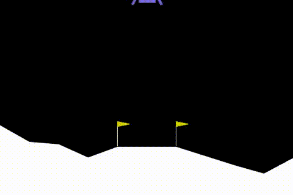
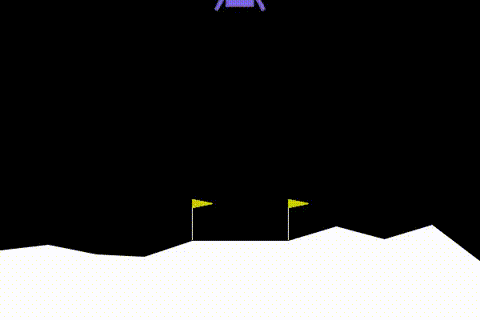
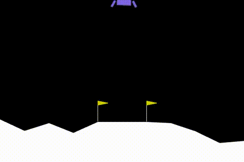

# Lunar Lander: Reward Shaping with PPO

I trained a reinforcement learning agent to land a rocket, then deliberately **broke it with a bad reward** and fixed it. The agent learns only from the points it earns, so what you reward decides what it learns.

| Baseline (built-in reward) | Hover bug (bad reward) | Fixed (progress shaping) |
|:---:|:---:|:---:|
|  |  |  |

## Highlights

- Trained a **PPO** agent (Stable-Baselines3) on `LunarLander-v3`; solved means an average score of 200+.
- Built a custom **reward wrapper** around the environment with four modes.
- Showed the effect of a **badly designed reward**: a "+1 per stable frame" bonus dropped the true-reward score from about 260 to about 130-160 and left the task unsolved.
- Fixed it with **progress-based shaping**: pay for improvement between frames, plus a small per-frame time cost. Both seeds solved the task (270 and 275).
- Evaluated on the **raw environment with the wrapper off**, so my own bonuses could not inflate the score.

## Reward modes

| Mode | Added to the built-in reward | Purpose |
|---|---|---|
| `none` | Nothing | Baseline |
| `time` | -0.05 every frame | Small charge for taking too long |
| `hover_bug` | +1 each frame the rocket is upright and slow | Intentionally broken. Hovering can collect more points than landing |
| `fixed` | +10 x (change in own position score), -0.05 every frame | Rewards getting better, not sitting in a good spot |

A reward for a *state* can be farmed forever. A reward for *improvement between states* cannot.

## Quickstart

Requires Python 3.10 to 3.12.

```bash
conda create -n lunar python=3.12 -y && conda activate lunar
pip install swig
pip install -r requirements.txt

python lander.py train --mode none       # baseline, ~20-40 min on a laptop CPU
python lander.py eval  --mode none       # 20 episodes, wrapper off
python lander.py record --mode none      # clips saved to videos/none/

python lander.py train --mode hover_bug  # watch it learn to hover
python lander.py train --mode fixed      # the fix
```

Options: `--steps 1000000` and `--seed 0`. `--seed` also picks which saved model `eval`, `watch` and `record` use. Other commands: `random` (watch a random rocket crash) and `watch` (live window).

## Results

Evaluation uses 20 episodes per run with the wrapper off.

| Mode | Seed | Mean reward | Std | Solved (200+)? |
|---|---|---|---|---|
| none | 0 | 261.9 | 19.8 | Yes |
| none | 1 | 256.8 | 23.0 | Yes |
| hover_bug | 0 | 129.4 | 58.6 | No |
| hover_bug | 1 | 160.9 | 40.6 | No |
| fixed | 0 | 269.8 | 20.5 | Yes |
| fixed | 1 | 275.0 | 19.2 | Yes |

The baseline and fixed modes solved the task on both seeds (about 257 to 275). The `hover_bug` agents scored clearly lower on the true reward (129 to 161) with much higher variance.

## What I learned

- **A reward you add can hurt the real goal.** The `hover_bug` agents scored 129 to 161 on the true reward, while the same setup without the bonus scored about 260. [Add what the clip shows: e.g. how long it hovers before landing.]
- **Reward what you want, not a proxy for it.** Paying for a nice state invites the agent to sit in it.
- **Training is noisy.** Results change with the seed, so one run is not evidence.

## References

- [Gymnasium: Lunar Lander](https://gymnasium.farama.org/environments/box2d/lunar_lander/)
- [Stable-Baselines3](https://stable-baselines3.readthedocs.io/)
- Schulman et al., 2017. [Proximal Policy Optimization Algorithms](https://arxiv.org/abs/1707.06347)

## License

MIT. See [LICENSE](LICENSE).